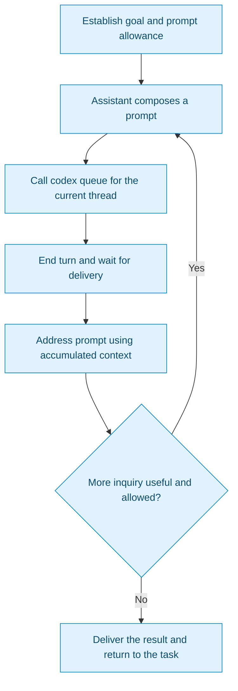

# Meta-prompting

A skill for constructing useful context through self-generated prompts in the
active conversation. The assistant chooses each next prompt and calls
`codex queue` directly to deliver its exact text as user input to the same thread.

This README is the human guide. [SKILL.md](skills/meta-prompting/SKILL.md)
contains the assistant's operating instructions.

## Installation

Choose where the skill should be available:

| Scope | Availability | Installer destination |
| --- | --- | --- |
| Project-local | One project | `<project>/.agents/skills/meta-prompting/` |
| User account (“global”) | Across your projects | `$CODEX_HOME/skills/meta-prompting/`, normally `~/.codex/skills/meta-prompting/` |

“Global” means your user account, not every user on the computer. Choose one
scope to avoid duplicate installations.

### User-account installation

Open Codex, then enter this in the Codex chat box:

```text
Use $skill-installer to install https://github.com/adamjpatterson/meta-prompting/tree/main/skills/meta-prompting
```

### Project-local installation

Open Codex in the destination project, then enter this in the Codex chat box:

```text
Use $skill-installer to install https://github.com/adamjpatterson/meta-prompting/tree/main/skills/meta-prompting into this project's .agents/skills directory using --dest.
```

The assistant reports the installation location. If the skill does not appear in
`/skills`, restart Codex. For an existing copy, see [Updating](#updating).

### From the terminal

These Bash examples use the Python helper bundled with Codex's skill-installer.
If your installation does not contain that helper, use the manual instructions
below.

For your **user account**, run from any directory:

```bash
python3 "${CODEX_HOME:-$HOME/.codex}/skills/.system/skill-installer/scripts/install-skill-from-github.py" \
  --repo adamjpatterson/meta-prompting \
  --path skills/meta-prompting
```

For **one project**, run from that project's root directory:

```bash
python3 "${CODEX_HOME:-$HOME/.codex}/skills/.system/skill-installer/scripts/install-skill-from-github.py" \
  --repo adamjpatterson/meta-prompting \
  --path skills/meta-prompting \
  --dest "$PWD/.agents/skills"
```

The helper creates the `meta-prompting` folder inside the destination. Both
commands download from GitHub and refuse to overwrite an existing installation.
Python is needed for this installer helper, not for using meta-prompting.

### Manual installation in a project

If the skill installer is unavailable or you prefer a project-local copy,
install the package by copying one folder:

1. Download or clone [adamjpatterson/meta-prompting](https://github.com/adamjpatterson/meta-prompting).
2. In the project where you want to use the skill, create `.agents/skills/` if it
   does not already exist.
3. Copy `skills/meta-prompting/` from this repository into that directory. Copy
   the whole folder, including `LICENSE`; the result should look like this:

   ```text
   your-project/
     .agents/
       skills/
         meta-prompting/
           SKILL.md
           LICENSE
           agents/
           references/
   ```

4. Open Codex in the destination project and look for `meta-prompting` in
   `/skills`, or type `$meta-prompting`. Restart Codex if it does not appear.

Copy the source folder in step 3, not this repository's symbolic link. If the
destination already contains `meta-prompting`, review that installation before
replacing it.

To make the skill available across your projects instead, copy the same folder
to `~/.agents/skills/meta-prompting/`. Choose either a project installation or a
personal installation to avoid duplicate entries.

### Updating

An installed copy does not automatically follow changes on GitHub. Ask the
assistant to locate the copy you use before updating it, especially if both a
project installation and a personal installation exist.

The installer refuses to overwrite an existing destination. For an installer-managed
copy, ask the assistant to preserve any local edits, replace that installation
with the latest GitHub package, and confirm its location. This is an update task
for the assistant, not a built-in overwrite option of the installer.

For a manually copied installation, download the current package and replace the
files in the same destination after preserving local edits. If your installation
is a symbolic link to a Git checkout, update that checkout instead of replacing
the link. Keep one active installation to avoid loading an older duplicate.
After updating, ask the assistant to reread the installed `SKILL.md`.

### Try it

Ask the assistant to check that `codex queue --help` works in its execution
environment, then try:

> Use $meta-prompting for a one-prompt delivery check. Queue the question
> “What is the purpose of this skill?” to this conversation, respond when it
> arrives, then stop without queueing another prompt.

You should see the question arrive as a new user-input message in the same
conversation, followed by the assistant's response. The inquiry should end there.

## Use

The skill instructs the assistant to initiate an inquiry when work repeats without
progress, relies on an untested premise, accumulates complexity, or drifts from
the goal. It can reconsider the approach while preserving your objective.
You can also request it directly:

> Use $meta-prompting to develop an approach to [your problem]. Allow up to four
> prompts and stop when there is a concrete next action.

### Anatomy of the prompt

The request has four parts:

| Part              | Example                                     | Purpose                                                                    |
| ----------------- | ------------------------------------------- | -------------------------------------------------------------------------- |
| Skill instruction | `Use $meta-prompting`                       | Selects the skill                                                          |
| Problem statement | `develop an approach to [your problem]`     | Gives the inquiry a goal; replace the placeholder with your actual problem |
| Prompt allowance  | `Allow up to four prompts`                  | Sets the maximum number of self-generated prompts, including the first     |
| Stop condition    | `stop when there is a concrete next action` | Describes when the inquiry has accomplished enough                         |

The allowance is a ceiling, not a target. The assistant can stop earlier when the
condition is met. You can omit the allowance and stop condition and let the
assistant choose them from the task. Each queued prompt starts a subsequent
conversation turn; the allowance counts those prompts, not tool calls.

### A first task

For a concrete first task, open a project with a README and enter this in the
Codex chat box:

> Use $meta-prompting to review this project's README from a first-time user's
> perspective. Allow up to three prompts. Stop when you have identified the most
> important onboarding improvement and explained why it matters. Present your
> recommendation before editing.

The assistant can question its own assumptions and explore another framing.
Definitions, names, and maps it develops remain revisable; routine tasks with a
clear approach can proceed directly.

## How it works



Codex supplies model execution and message delivery. The skill guides the
assistant in choosing prompts and using their responses to clarify the task,
reconsider assumptions, or bring a wandering conversation back to its goal.

### Prompt delivery

The assistant operates the queue; you do not need to paste its prompts. For example,
it can submit a prompt using Bash:

```bash
codex queue --thread "${CODEX_THREAD_ID:?Current thread is unavailable}" \
  --message 'What observation would let the user recognize success?'
```

The assistant then ends its turn. A successful command establishes acceptance;
actual arrival must be observed in the conversation before continuing.

## Requirements

The host must provide a shell tool, `codex queue`, and `CODEX_THREAD_ID` for the
active conversation. The skill uses the existing Codex session; it needs no
separate model or API key.

### Execution permissions

The shell launches `codex queue`, which connects to a local Codex app server or
starts one as needed. The app server accepts the request to add a message to the
conversation. You normally do not need to start it manually.

- **Restricted access:** the sandbox may block filesystem access needed to start
  or contact the app server. The assistant can request broader access for the
  command when the host's approval settings permit it.
- **Full access:** commands run without the filesystem sandbox restriction, so
  that sandbox approval step is unnecessary. Operating-system permissions still
  apply.

Full access is not required. The requirement is that the command can reach a
working app server, either within the sandbox or through approved execution.
These settings belong to the host, not the skill. See the
[Codex permissions guide](https://learn.chatgpt.com/docs/permission-modes).

## State and stopping

The skill instructs the assistant to keep the goal, prompt allowance, and pending
prompt in the conversation. It calls for one pending prompt at a time and stopping
when the goal is met or the allowance is exhausted. The assistant tracks the
allowance itself.

If sending fails with an uncertain outcome, the skill instructs the assistant
to stop instead of retrying automatically: the prompt may already have been
accepted. It also instructs the assistant to respect new user directions,
including a request to stop while a prompt is pending.

## Compatibility and validation

Development checks used Codex CLI **0.169.0** on Linux with Bash and an active
Codex conversation. See the [validation notes](skills/meta-prompting/references/validation.md) for the
checks performed and their results.

## Troubleshooting

### Skill is missing from the selector

Restart Codex if the skill does not appear in `/skills`. Check which installation
location was used and avoid keeping both an outdated personal copy and a project
copy. You can also ask the assistant to read the installed `SKILL.md` directly.

### Queue startup fails

`codex queue` needs to communicate with the local Codex app server. A restricted
execution environment may block access to the server's local files or connection.
In our development environment, the command worked when run with broader host
permissions. An explicit error such as `failed to start embedded app server:
Read-only file system` occurs during startup, before message submission. The
skill instructs the assistant to use the host's normal permission process to
resolve that failure and retry the same prompt once. The error need not identify
the exact write path to distinguish this startup failure from an uncertain send.

A timeout or lost connection can leave submission uncertain. In that case, the
assistant should inspect delivery evidence rather than automatically resending.
If the host cannot grant the needed access, the assistant reports the blocker.

## Discovery in this repository

The source package is `skills/meta-prompting/`. Codex discovers project skills
under `.agents/skills/`, so `.agents/skills/meta-prompting` is a symbolic link to
the source folder. This lets Codex read the files being edited without keeping
a second copy. Automatic selection is enabled in `agents/openai.yaml`.

The [Agent Skills specification](https://agentskills.io/specification) defines
the package format; [Codex's skill guide](https://learn.chatgpt.com/docs/build-skills#where-to-save-skills)
defines discovery locations. The outer `skills/` folder is our repository
organization, not a required part of an installed skill.

Development checks are recorded in the [validation notes](skills/meta-prompting/references/validation.md).

## Layout

```text
README.md                   Human-facing guide
skills/meta-prompting/
  SKILL.md                  Operating instructions
  LICENSE                   Standalone package license
  references/example.md     Illustrative inquiry
  references/validation.md  Validation scope and results
  agents/openai.yaml        Codex metadata and invocation policy
.agents/skills/             Project-local discovery link
```

The skill folder contains its instructions, license, and supporting references.
It can be installed independently; the human guide remains in this repository.

## Development

The skill's behavior is defined in `skills/meta-prompting/SKILL.md`. Keep that
file and the human-facing README consistent when changing the workflow.

After editing, check that documentation links resolve and that the skill's name
and description remain valid. If your Codex installation includes the
skill-creator validator, use it to check the package metadata.

For workflow changes, try a short inquiry in an active Codex conversation. Verify
that each queued prompt arrives in the same conversation, that the next prompt
builds on the preceding response, and that the inquiry stops at its goal or
prompt allowance. Record the environment and observations in the
[validation notes](skills/meta-prompting/references/validation.md).

## License

[MIT](LICENSE).
