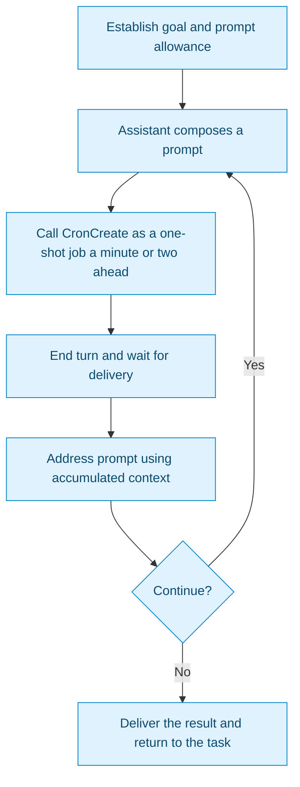

# Meta-prompting for Claude Code

This package uses Claude Code's built-in `CronCreate` tool to schedule a prompt for the current session, end the current turn, and continue after arrival in the same conversation.

These instructions target `main`. Version `0.3.0` adds this package alongside the Codex and OpenCode packages.

## Installation

Claude Code discovers skills in its native [skill locations](https://code.claude.com/docs/en/skills). Install the package by copying one folder:

1. Clone [adamjpatterson/meta-prompting](https://github.com/adamjpatterson/meta-prompting) and check out `main`.
2. Choose one installation scope:
   - Project: `<your-project>/.claude/skills/meta-prompting-claude/`. Commit it to share with collaborators.
   - User account: `~/.claude/skills/meta-prompting-claude/`, available across your projects.
3. Copy `skills/meta-prompting-claude/` from this repository into that location. Copy the whole folder; the result should look like this:

   ```text
   your-project/
     .claude/
       skills/
         meta-prompting-claude/
           SKILL.md
           LICENSE
           references/
   ```

4. Open Claude Code in the destination project, type `/`, and look for `meta-prompting-claude` in the menu without submitting it. This checks discovery. To run the first inquiry, use the example under [Try it](#try-it) below. Claude Code watches its skill directories, so no restart should be needed; run `/reload-skills` if the skill does not appear. During development in the VS Code extension, a skill added through a symbolic link appeared only after a window reload, so reload the window or restart the session as a fallback.

Use one installation scope to avoid duplicate entries. Do not install the Codex or OpenCode package for Claude Code sessions.

### Updating

Replace the installed folder with the current package from the same branch after preserving any local edits. Ask the assistant to reread its `SKILL.md`. If you installed using a symbolic link to a Git checkout, update that checkout instead.

### Try it

Ask the assistant to confirm that the `CronCreate` tool is available in its session, then try:

> Use /meta-prompting-claude for a one-prompt delivery check. Schedule the question “What is the purpose of this skill?” for this conversation, respond when it arrives, then stop without scheduling another prompt.

The assistant schedules the prompt a minute or two ahead and ends its turn with a handoff that states the question and the count. Within about two minutes, the assistant should respond again in the same conversation, opening with a note that the prompt arrived, followed by its answer. The inquiry should end there. In the VS Code extension, the scheduled prompt itself is not displayed as a message, unlike on Codex and OpenCode; see [Visibility](#visibility).

## Usage

The skill instructs the assistant to initiate an inquiry when work repeats without progress, relies on an untested premise, accumulates complexity, or drifts from the goal. It can reconsider the approach while preserving your objective. You can also request it directly:

> Use /meta-prompting-claude to develop an approach to [your problem]. Allow up to four prompts and stop when there is a concrete next action.

### Anatomy of the prompt

The request has four parts:

| Part              | Example                                     | Purpose                                                                    |
| ----------------- | ------------------------------------------- | -------------------------------------------------------------------------- |
| Skill instruction | `Use /meta-prompting-claude`                | Selects the skill                                                          |
| Problem statement | `develop an approach to [your problem]`     | Gives the inquiry a goal; replace the placeholder with your actual problem |
| Prompt allowance  | `Allow up to four prompts`                  | Sets the maximum number of self-generated prompts, including the first     |
| Stop condition    | `stop when there is a concrete next action` | Describes when the inquiry has accomplished enough                         |

The allowance is a ceiling, not a target. The assistant can stop earlier when the condition is met. You can omit both: the assistant chooses an allowance and judges when the inquiry has clarified enough. Each scheduled prompt starts a subsequent conversation turn; the allowance counts those prompts, not tool calls.

### A first task

For a concrete first task, open a project with a README and enter this in Claude Code:

> Use /meta-prompting-claude to review this project's README from a first-time user's perspective. Allow up to three prompts. Stop when you have identified the most important onboarding improvement and explained why it matters. Present your recommendation before editing.

The assistant can question its own assumptions and explore another framing. Definitions, names, and maps it develops remain revisable; routine tasks with a clear approach can proceed directly.

## How it works



Claude Code supplies model execution and message delivery. The skill guides the assistant in choosing prompts and using their responses to clarify the task, reconsider assumptions, or bring a wandering conversation back to its goal. The inquiry continues only while another prompt would help, the goal remains unmet, and the prompt allowance has not been exhausted.

### Prompt delivery

The assistant operates the scheduler; you do not need to paste its prompts. It checks the local time and calls `CronCreate` with the prompt, a cron expression pinned to a time one to two minutes ahead, and `recurring` set to `false`. Claude Code enqueues the prompt when that minute arrives and the session is idle, and the prompt starts a new turn as user input.

The assistant then ends its turn. A successful tool result establishes acceptance and reports the next run time; the skill specifies that the assistant must observe actual arrival in the conversation before continuing.

Delivery is slower than a direct queue: scheduling has one-minute granularity, and jobs fire only between turns. Jobs on round minutes may fire up to about ninety seconds early.

### Visibility

Claude Code stores a scheduled prompt in the session transcript as a user-role message, but marks it as a meta message with a scheduled origin, and the VS Code extension does not render such messages in the chat. The model receives the prompt as user input; you do not see it. Codex and OpenCode display the self-generated prompt as an ordinary user message. To keep the inquiry readable, the skill instructs the assistant to state each scheduled prompt verbatim in its handoff and to open the next response with an arrival note. Rendering in the terminal interface has not been checked.

## Requirements

The host must provide the `CronCreate`, `CronList`, and `CronDelete` tools in an interactive Claude Code session. The skill uses the existing session; it needs no shell command, session identifier, separate model, or API key.

### Execution permissions

`CronCreate` is a built-in tool, so the host's permission mode governs whether the call needs approval. Scheduling can be disabled host-wide with the `CLAUDE_CODE_DISABLE_CRON` environment variable; in that case the skill reports the blocker rather than using another delivery path. Scheduled jobs live in the session and fire only while Claude Code is running and idle.

## State and stopping

The skill instructs the assistant to keep the goal, prompt allowance, and pending prompt in the conversation. It calls for one pending prompt at a time and stopping when the goal is met or the allowance is exhausted. The assistant tracks the allowance itself.

If a call is rejected before scheduling, the prompt was never submitted and the attempt does not consume the allowance. If a call was accepted but the prompt has not arrived, the skill instructs the assistant to check `CronList` before deciding how to recover, rather than scheduling a duplicate. It also instructs the assistant to respect new user directions, including a request to stop while a prompt is pending.

## Compatibility and validation

The original development check used Claude Code **2.1.287** in the VS Code extension on Linux with an active interactive conversation. See the [validation notes](validation/claude.md) for the checks performed, including a two-prompt adaptive inquiry, their results, and the checks that remain untested.

## Troubleshooting

### Skill is missing from the selector

Run `/reload-skills` if the skill does not appear after installation. If it still does not appear, reload the window in the VS Code extension or restart the session; that was needed once during development. Check which installation location was used and avoid keeping both an outdated personal copy and a project copy. You can also ask the assistant to read the installed `SKILL.md` directly.

### Scheduling is rejected

If the `CronCreate` call is denied or the tool is absent, the prompt was not scheduled. Check the permission mode and whether scheduling is disabled by the environment variable. The skill instructs the assistant to resolve the problem through the host's normal permission process and retry the same prompt once, without resuming the session from a shell or posting to the session's messaging socket.

### Prompt does not arrive

In the VS Code extension the conversation does not show the scheduled prompt itself; look for the assistant's arrival note instead. Scheduled prompts fire only while the session is idle. If the assistant is still working or waiting on another tool, the prompt waits. If the session was closed or resumed, pending jobs may not survive; the skill instructs the assistant to inspect the job list and report rather than resend automatically. See [schedule recovery](../skills/meta-prompting-claude/references/schedule-recovery.md).

## Development

The skill follows the [Agent Skills specification](https://agentskills.io/specification). Its source is in `skills/meta-prompting-claude/`; `.claude/skills/meta-prompting-claude` links to that folder so Claude Code can discover the working copy during development.

The skill's behavior is defined in `skills/meta-prompting-claude/SKILL.md`. Keep that file and this guide consistent when changing the workflow.

After editing, check that documentation links resolve and validate the package with the [Agent Skills reference validator](https://github.com/agentskills/agentskills/tree/main/skills-ref). Install it in a separate development environment using its installation instructions, then run from this repository's root:

```bash
skills-ref validate skills/meta-prompting-claude
```

The validator checks package metadata; it does not test prompt delivery or behavior.

For workflow changes, try a short inquiry in an active Claude Code conversation. Verify that each scheduled prompt arrives in the same conversation, that the next prompt builds on the preceding response, and that the inquiry stops at its goal or prompt allowance. Record the environment and observations in the [validation notes](validation/claude.md).
