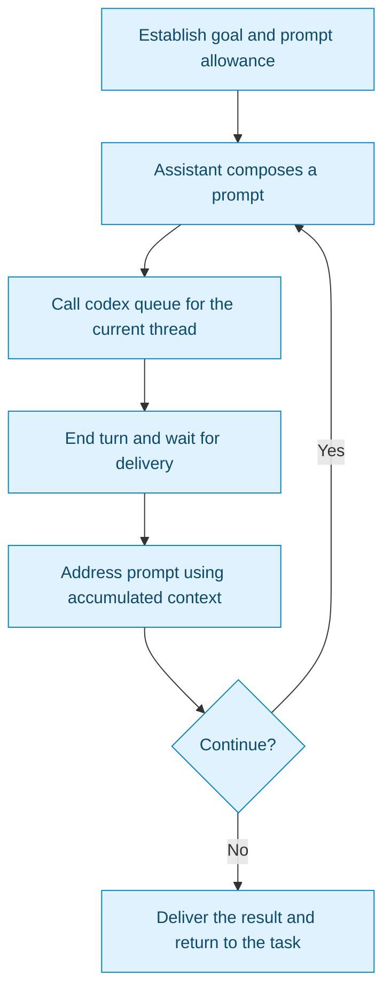

# Meta-prompting for Codex

This package uses `codex queue` to deliver a prompt, end the current turn, and continue after arrival in the same conversation.

These instructions target `main`. Version `0.2.0` introduced the client-specific package names; earlier releases use `meta-prompting`. Skills share the repository version, currently `0.3.0`.

## Installation

### User-account installation

Open Codex, then enter this in the Codex chat box:

```text
Use $skill-installer to install the meta-prompting-codex skill from adamjpatterson/meta-prompting, path skills/meta-prompting-codex, using --ref main into ~/.agents/skills using --dest.
```

The skill will be installed to `~/.agents/skills/meta-prompting-codex/`, available across your projects.

### Project-local installation

Open Codex in the destination project, then enter this in the Codex chat box:

```text
Use $skill-installer to install the meta-prompting-codex skill from adamjpatterson/meta-prompting, path skills/meta-prompting-codex, using --ref main into this project's .agents/skills directory using --dest.
```

The skill will be installed to `<your-project>/.agents/skills/meta-prompting-codex/`.

The assistant reports the installation location. If the skill does not appear in `/skills`, restart Codex. For an existing copy, see [Updating](#updating).

### Manual installation

If the skill installer is unavailable or you prefer a project-local copy, install the package by copying one folder:

1. Clone [adamjpatterson/meta-prompting](https://github.com/adamjpatterson/meta-prompting) and check out `main`.
2. In the project where you want to use the skill, create `.agents/skills/` if it does not already exist.
3. Copy `skills/meta-prompting-codex/` from this repository into that directory. Copy the whole folder; the result should look like this:

   ```text
   your-project/
     .agents/
       skills/
         meta-prompting-codex/
           SKILL.md
           LICENSE
           agents/
           references/
   ```

4. Open Codex in the destination project and look for `meta-prompting-codex` in `/skills`, or type `$meta-prompting-codex`. Restart Codex if it does not appear.

To make the skill available across your projects instead, copy the same folder to `~/.agents/skills/meta-prompting-codex/`. Choose either a project installation or a personal installation to avoid duplicate entries.

### Updating

To update, ask Codex:

```text
Update my installed meta-prompting-codex skill from https://github.com/adamjpatterson/meta-prompting, branch main, path skills/meta-prompting-codex. Keep its current installation location and preserve any local edits. Reread the updated SKILL.md when finished.
```

For a manual installation, replace the skill folder with the latest copy after preserving any local edits. If you installed using a symbolic link to a Git checkout, update that checkout instead.

### Try it

Ask the assistant to check that `codex queue --help` works in its execution environment, then try:

> Use $meta-prompting-codex for a one-prompt delivery check. Queue the question “What is the purpose of this skill?” to this conversation, respond when it arrives, then stop without queueing another prompt.

You should see the question arrive as a new user-input message in the same conversation, followed by the assistant's response. The inquiry should end there.

## Usage

The skill instructs the assistant to initiate an inquiry when work repeats without progress, relies on an untested premise, accumulates complexity, or drifts from the goal. It can reconsider the approach while preserving your objective. You can also request it directly:

> Use $meta-prompting-codex to develop an approach to [your problem]. Allow up to four prompts and stop when there is a concrete next action.

### Anatomy of the prompt

The request has four parts:

| Part              | Example                                     | Purpose                                                                    |
| ----------------- | ------------------------------------------- | -------------------------------------------------------------------------- |
| Skill instruction | `Use $meta-prompting-codex`                       | Selects the skill                                                          |
| Problem statement | `develop an approach to [your problem]`     | Gives the inquiry a goal; replace the placeholder with your actual problem |
| Prompt allowance  | `Allow up to four prompts`                  | Sets the maximum number of self-generated prompts, including the first     |
| Stop condition    | `stop when there is a concrete next action` | Describes when the inquiry has accomplished enough                         |

The allowance is a ceiling, not a target. The assistant can stop earlier when the condition is met. You can omit both: the assistant chooses an allowance and judges when the inquiry has clarified enough. Each queued prompt starts a subsequent conversation turn; the allowance counts those prompts, not tool calls.

### A first task

For a concrete first task, open a project with a README and enter this in the Codex chat box:

> Use $meta-prompting-codex to review this project's README from a first-time user's perspective. Allow up to three prompts. Stop when you have identified the most important onboarding improvement and explained why it matters. Present your recommendation before editing.

The assistant can question its own assumptions and explore another framing. Definitions, names, and maps it develops remain revisable; routine tasks with a clear approach can proceed directly.

## How it works



Codex supplies model execution and message delivery. The skill guides the assistant in choosing prompts and using their responses to clarify the task, reconsider assumptions, or bring a wandering conversation back to its goal. The inquiry continues only while another prompt would help, the goal remains unmet, and the prompt allowance has not been exhausted.

### Prompt delivery

The assistant operates the queue; you do not need to paste its prompts. For example, it can submit a prompt using Bash:

```bash
codex queue --thread "${CODEX_THREAD_ID:?Current thread is unavailable}" \
  --message 'What observation would let the user recognize success?'
```

The assistant then ends its turn. A successful command establishes acceptance; the skill specifies that the agent must observe actual arrival in the conversation before continuing.

## Requirements

The host must provide a shell tool, `codex queue`, and `CODEX_THREAD_ID` for the active conversation. The skill uses the existing Codex session; it needs no separate model or API key.

### Execution permissions

The shell launches `codex queue`, which connects to a local Codex app server or starts one as needed. The app server accepts the request to add a message to the conversation.

- **Restricted access:** the sandbox may block filesystem access needed to start or contact the app server. The assistant can request broader access for the command when the host's approval settings permit it.
- **Full access:** commands run without the filesystem sandbox restriction, so that sandbox approval step is unnecessary. Operating-system permissions still apply.

Full access is not required. The requirement is that the command can reach a working app server, either within the sandbox or through approved execution. These settings belong to the host, not the skill. See the [Codex permissions guide](https://learn.chatgpt.com/docs/permission-modes).

## State and stopping

The skill instructs the assistant to keep the goal, prompt allowance, and pending prompt in the conversation. It calls for one pending prompt at a time and stopping when the goal is met or the allowance is exhausted. The assistant tracks the allowance itself.

If sending fails with an uncertain outcome, the skill instructs the assistant to inspect delivery evidence before deciding how to recover, rather than resend automatically: the prompt may already have been accepted. It also instructs the assistant to respect new user directions, including a request to stop while a prompt is pending.

## Compatibility and validation

The original development checks used Codex CLI **0.169.0** on Linux with Bash and an active Codex conversation. See the [validation notes](../skills/meta-prompting-codex/references/validation.md) for the checks performed and their results.

## Troubleshooting

### Skill is missing from the selector

Restart Codex if the skill does not appear in `/skills`. Check which installation location was used and avoid keeping both an outdated personal copy and a project copy. You can also ask the assistant to read the installed `SKILL.md` directly.

### Queue startup fails

`codex queue` needs to communicate with the local Codex app server. A restricted execution environment may block access to the server's local files or connection. In our development environment, the command worked when run with broader host permissions. An explicit error such as `failed to start embedded app server: Read-only file system` occurs during startup, before message submission. The skill instructs the assistant to use the host's normal permission process to resolve that failure and retry the same prompt once. The error need not identify the exact write path to distinguish this startup failure from an uncertain send.

A timeout or lost connection can leave submission uncertain. In that case, the assistant should inspect delivery evidence rather than automatically resending. If the host cannot grant the needed access, the assistant reports the blocker.

## Development

The skill follows the [Agent Skills specification](https://agentskills.io/specification). Its source is in `skills/meta-prompting-codex/`; `.agents/skills/meta-prompting-codex` links to that folder so Codex can discover the working copy during development.

The skill's behavior is defined in `skills/meta-prompting-codex/SKILL.md`. Keep that file and the client guide consistent when changing the workflow.

After editing, check that documentation links resolve and validate the package with the [Agent Skills reference validator](https://github.com/agentskills/agentskills/tree/main/skills-ref). Install it in a separate development environment using its installation instructions, then run from this repository's root:

```bash
skills-ref validate skills/meta-prompting-codex
```

The validator checks package metadata; it does not test prompt delivery or behavior.

For workflow changes, try a short inquiry in an active Codex conversation. Verify that each queued prompt arrives in the same conversation, that the next prompt builds on the preceding response, and that the inquiry stops at its goal or prompt allowance. Record the environment and observations in the [validation notes](../skills/meta-prompting-codex/references/validation.md).

