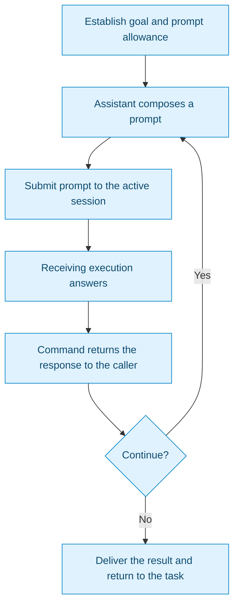

# Meta-prompting for OpenCode

This package uses `opencode run -s` to submit a self-generated prompt to the active session. The call waits for a response; the calling agent then decides whether to continue.

These instructions target the `main` branch of this repository.

## Installation

OpenCode discovers skills in its native [skill locations](https://opencode.ai/docs/skills/). Install the package by copying one folder:

1. Clone [adamjpatterson/meta-prompting](https://github.com/adamjpatterson/meta-prompting) and check out `main`.
2. Choose one installation scope:
   - Project: `<your-project>/.opencode/skills/meta-prompting-opencode/`, for use in that project.
   - User account: `~/.config/opencode/skills/meta-prompting-opencode/`, available across your projects.
3. Copy `skills/meta-prompting-opencode/` from this repository into that location. Copy the whole folder, including its license and references; a project installation should look like this:

   ```text
   your-project/
     .opencode/
       skills/
         meta-prompting-opencode/
           SKILL.md
           LICENSE
           references/
   ```

4. Open OpenCode in the destination project and ask it to load `meta-prompting-opencode` using its skill tool and confirm the installation path. This checks discovery. To run the first inquiry, use the example under [Try it](#try-it). If the skill cannot be found, see [Troubleshooting](#skill-is-not-found).

Choose one installation scope to avoid duplicate entries.

### Updating

Replace the installed folder with the current package from the same branch after preserving local edits. Ask the agent to reread its `SKILL.md`. Keep the installation in its existing scope.

### Try it

Ask the assistant to check that `opencode run --help` works in its execution environment, then enter:

> Use the meta-prompting-opencode skill for a one-prompt delivery check. Submit the question “What is the purpose of this skill?” to this conversation, report when its response returns, and stop without submitting another prompt.

The submitted question and its answer should appear in the same session's history. The command returns the answer, and the assistant reports completion without another submission. You can ask it to inspect the session history to confirm that the question and answer each appear once.

## Usage

The skill instructs the assistant to initiate an inquiry when work repeats without progress, relies on an untested premise, accumulates complexity, or drifts from the goal. It can reconsider the approach while preserving your objective. You can also request it directly:

> Use the meta-prompting-opencode skill to develop an approach to [your problem]. Allow up to four prompts and stop when there is a concrete next action.

### Anatomy of the prompt

The request has four parts:

| Part | Example | Purpose |
| --- | --- | --- |
| Skill instruction | `Use the meta-prompting-opencode skill` | Selects the skill |
| Problem statement | `develop an approach to [your problem]` | Gives the inquiry a goal; replace the placeholder with your actual problem |
| Prompt allowance | `Allow up to four prompts` | Sets the maximum number of self-generated prompts, including the first |
| Stop condition | `stop when there is a concrete next action` | Describes when the inquiry has accomplished enough |

The allowance is a ceiling, not a target. The assistant can stop earlier when the condition is met. You can omit both: the assistant chooses an allowance and judges when the inquiry has clarified enough. Each submitted prompt counts once; commands used to identify or inspect the session do not consume the allowance.

### A first task

For a concrete first task, open a project with a README and enter this in OpenCode:

> Use the meta-prompting-opencode skill to review this project's README from a first-time user's perspective. Allow up to three prompts. Stop when you have identified the most important onboarding improvement and explained why it matters. Present your recommendation before editing.

The assistant can question its own assumptions and explore another framing. Definitions, names, and maps it develops remain revisable; routine tasks with a clear approach can proceed directly.

## How it works



OpenCode supplies model execution and message delivery. The assistant that starts the inquiry manages the loop: it uses each returned response to decide whether another prompt would help. The inquiry continues while the goal remains unmet and the prompt allowance has not been exhausted.

### Prompt delivery

The assistant operates the command; you do not need to paste its prompts. It verifies the current session using `opencode session list` and matching conversation history from `opencode export <session-id>`. For example, it can submit a prompt using Bash:

```bash
opencode run -s '<active-session-id>' \
  'What observation would let the user recognize success? Answer without submitting another prompt.'
```

The `-s` argument selects the existing session. The call waits until the response returns. The skill instructs the receiving execution to answer without submitting another prompt, leaving follow-up decisions to the assistant that made the call. That assistant uses the returned response to continue the inquiry or report its result; it does not answer the same prompt a second time.

## Requirements

The host must provide OpenCode, a shell tool, the `opencode` executable, and access to the active session. The assistant verifies the session ID before submission. The skill uses your configured OpenCode installation and an existing conversation.

### Execution permissions

OpenCode's [permission settings](https://opencode.ai/docs/permissions/) govern whether the assistant can load the skill and run shell commands. The command also needs access to the session storage and model configuration used by your OpenCode session. If access is blocked, ask the assistant to identify the missing permission so you can resolve it through your normal host settings.

## State and stopping

The skill instructs the assistant to keep the goal, prompt allowance, and pending prompt in the conversation. It calls for one pending prompt at a time and stopping when the goal is met, another prompt would not help, or the allowance is exhausted. The assistant tracks the allowance itself.

The assistant that starts the inquiry manages subsequent submissions after each command returns. The skill also instructs it to respect newer user directions, including a request to stop, and to leave a stopped inquiry closed when a delayed response arrives.

## Compatibility and validation

A reported one-prompt check used **OpenCode 1.19.6** on Linux with Bash and an active OpenCode session. See the [validation notes](validation/opencode.md) for its results and the checks still pending for this package.

## Troubleshooting

### Skill is not found

Check that the installed folder contains `SKILL.md`, `LICENSE`, and `references/`, and that it is in one of the locations listed under [Installation](#installation). Ask OpenCode which copy it is loading and remove outdated duplicate installations after preserving local edits. Also check whether your permission settings allow the assistant to load the skill. If discovery is unavailable, ask it to read the installed `SKILL.md` directly.

### Active session is unclear

If the assistant cannot identify your active session, ask it to explain the ambiguity so you can clarify which conversation to use. The skill requires it to confirm the session against the conversation history before submitting a prompt.

### Command is unavailable or blocked

Ask the assistant to check `opencode run --help` in its shell environment. If the executable cannot be found, make your OpenCode installation available in that environment. If access is denied, check the permissions described under [Execution permissions](#execution-permissions).

### Command hangs or times out

If a call hangs or times out, the prompt may already have arrived. Ask the assistant to check the session history before trying again to avoid submitting the same prompt twice.

## Development

The skill follows the [Agent Skills specification](https://agentskills.io/specification). Its source is in `skills/meta-prompting-opencode/`.

To change how the skill works, edit [SKILL.md](../skills/meta-prompting-opencode/SKILL.md) and update this guide to match. That file contains the instructions OpenCode follows when using the skill.

After editing, check that documentation links resolve and validate the package with the [Agent Skills reference validator](https://github.com/agentskills/agentskills/tree/main/skills-ref). Install it in a separate development environment using its installation instructions, then run from this repository's root:

```bash
skills-ref validate skills/meta-prompting-opencode
```

The validator checks package metadata; it does not test prompt delivery or behavior.

For workflow changes, ask OpenCode to run a short inquiry with a small prompt allowance. Inspect the session history and command results: each prompt should receive one reply, and the assistant that started the inquiry should choose any follow-up after the command returns. Check that follow-ups build on previous responses and that the inquiry stops at its goal or prompt allowance. Record your environment and observations in the [validation notes](validation/opencode.md).
