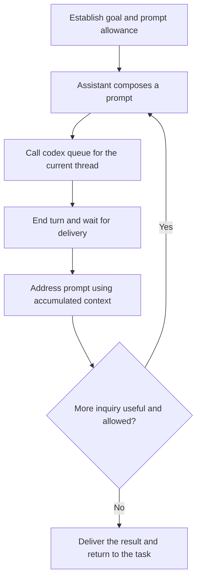

# Meta-prompting

Meta-prompting lets the assistant construct context for its own subsequent work.
It composes a prompt, calls `codex queue` directly, and responds when the host
delivers that prompt as user input in the same conversation. Each next prompt is
chosen from the context that develops.

The prompt may be a question, instruction, definition, or other useful context.
Its wording is fully assistant-controlled; there is no required label or wrapper.

## How it works



This is a skill made of instructions, not a separate model runner. The host
supplies model execution and message delivery. Live development tests confirmed
that queued messages arrived as user-role input in the same conversation and
received responses. That establishes the delivery mechanism in the tested host,
not a general reasoning advantage or knowledge of internal token serialization.

## Use

The assistant may initiate an inquiry when it would help the current task. You
can also ask explicitly:

> Use $meta-prompting to clarify [problem]. Allow up to four prompts. Stop when
> there is one concrete recommendation and a practical way to evaluate it.

The host must support shell commands, provide `codex queue`, and expose
`CODEX_THREAD_ID` for the active conversation. No Python installation, separate
model, or additional API key is required by the skill. Host execution permissions
still apply, and delivery support is not assumed for other clients.

The assistant operates the queue; you do not need to paste its prompts. For example,
it can submit a prompt using Bash:

```bash
codex queue --thread "${CODEX_THREAD_ID:?Current thread is unavailable}" \
  --message 'What observation would let the user recognize success?'
```

The assistant then ends its turn. A successful command establishes acceptance;
actual arrival must be observed in the conversation before continuing.

This repository registers the skill using `.agents/skills/meta-prompting`, a
symlink to this folder. Automatic selection is enabled in `agents/openai.yaml`;
explicit `$meta-prompting` invocation remains available. If discovery is unavailable,
ask the assistant to read [SKILL.md](SKILL.md) directly.

## Install in another project

Copy this entire `meta-prompting` folder, including `LICENSE`, into the destination
project as `.agents/skills/meta-prompting/`. Do not copy the development
repository's discovery symlink; its relative target belongs to that checkout.
If a folder with that name already exists, inspect it before replacing anything.

For personal use across projects, the alternative destination is
`~/.agents/skills/meta-prompting/`. Choose one location to avoid duplicate entries.
These locations follow the [Codex local skill discovery guide](https://learn.chatgpt.com/docs/build-skills#where-codex-loads-local-skills).

In the destination project, open Codex and check `/skills` or mention
`$meta-prompting`. If it does not appear, restart Codex. Check `codex queue --help`
in the execution environment; discovery alone does not establish that the host
can deliver messages to the active thread.

After installation, try this bounded check:

> Use $meta-prompting for a one-prompt delivery check. Queue the question
> “What is the purpose of this skill?” to this conversation, respond when it
> arrives, then stop without queueing another prompt.

Look for the queued question arriving as a new user-input message in the same
conversation, followed by a response and no further send. A successful queue
command alone is insufficient. Passing this check demonstrates delivery and one
instance of stopping in your environment; it does not prove general reliability
or better reasoning.

## Compatibility and validation

Development checks used Codex CLI **0.169.0** on Linux with Bash and a connected
active Codex conversation. This is a tested version, not a minimum-version claim.
Other versions, operating systems, and host configurations have not been verified.
In the tested sandbox, queueing needed permission to access the local app server
outside the restricted filesystem. The skill does not bypass host permissions.

See [validation notes](references/validation.md) for observed results and pending
checks. This is an experimental context-shaping capability; no general reasoning
improvement is claimed.

## State and stopping

The goal, stopping condition, number of prompts sent, and pending prompt remain
in the conversation. The skill creates no run directories or per-prompt files.
Codex may retain its own session and queue data; removing skill-specific records
does not disable host storage.

The assistant follows a finite allowance, counts the initial prompt, keeps one
prompt pending, and stops when the goal is met or the allowance is exhausted.
These are behavioral instructions, not programmatic enforcement. An uncertain
send must not be retried automatically because it may already have been accepted.
If context is lost or the pending prompt cannot be identified, the assistant
stops rather than reconstructing the state by guesswork.

This simpler design gives up independent counters and durable delivery records.
Research notes or results can still be saved when requested, in a location chosen
for that task. There is no logging subsystem or default output directory.

## Package

| File | Purpose |
| --- | --- |
| [SKILL.md](SKILL.md) | Assistant-facing workflow and stopping instructions |
| [agents/openai.yaml](agents/openai.yaml) | Display metadata and automatic selection |
| [references/example.md](references/example.md) | Illustrative inquiry |
| [references/validation.md](references/validation.md) | Validation scope and results |
| [LICENSE](LICENSE) | MIT license for the standalone package |

The skill folder can be copied without depending on other files in this repository.
