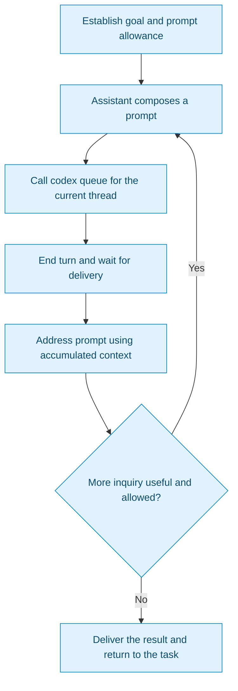

# Meta-prompting

Meta-prompting lets the assistant construct context for its own subsequent work.
It composes a prompt, calls `codex queue` directly, and responds when the host
delivers that prompt as user input in the same conversation. Each next prompt is
chosen from the context that develops.

The prompt may be a question, instruction, definition, or other useful context.
The assistant chooses both its wording and form to suit the task.

## How it works



Codex supplies model execution and message delivery. The skill guides the
assistant in choosing prompts and using their responses to clarify the task,
reconsider assumptions, or bring a wandering conversation back to its goal.

## Use

The skill instructs the assistant to notice when the current approach needs
reconsideration and initiate an inquiry without waiting for you to request one.
Typical signals include repeated attempts without progress, an untested premise,
growing complexity, or drift from your objective.

The assistant can question its own assumptions, distinguish a proposed solution
from your underlying goal, and construct a different framing for the next step.
Definitions, names, and maps it develops remain revisable. Routine tasks with a
clear approach can proceed directly.

You can also ask explicitly:

> Use $meta-prompting to develop an approach to [your problem]. Allow up to four
> prompts and stop when there is a concrete next action.

The request has four parts:

| Part | Example | Purpose |
| --- | --- | --- |
| Skill instruction | `Use $meta-prompting` | Selects the skill |
| Problem statement | `develop an approach to [your problem]` | Gives the inquiry a goal; replace the placeholder with your actual problem |
| Prompt allowance | `Allow up to four prompts` | Sets the maximum number of self-generated prompts, including the first |
| Stop condition | `stop when there is a concrete next action` | Describes when the inquiry has accomplished enough |

The allowance is a ceiling, not a target. The assistant can stop earlier when the
condition is met. You can omit the allowance and stop condition and let the
assistant choose them from the task. Each queued prompt starts a subsequent
conversation turn; the allowance counts those prompts, not tool calls.

For a concrete first task, open a project with a README and enter this in the
Codex chat box:

> Use $meta-prompting to review this project's README from a first-time user's
> perspective. Allow up to three prompts. Stop when you have identified the most
> important onboarding improvement and explained why it matters. Present your
> recommendation before editing.

## Requirements

The host must provide a shell tool, `codex queue`, and `CODEX_THREAD_ID` for the
active conversation. The skill uses the existing Codex session; it needs no
separate model or API key.

### Execution permissions

The shell launches `codex queue`, which connects to a local Codex app server or
starts one as needed. The app server accepts the request to add a message to the
conversation. You normally do not need to start it manually.

- **Restricted access:** the sandbox may block filesystem access needed to start
  or contact the app server. The assistant can request broader access for the
  command when the host's approval settings permit it.
- **Full access:** commands run without the filesystem sandbox restriction, so
  that sandbox approval step is unnecessary. Operating-system permissions still
  apply.

Full access is not required. The requirement is that the command can reach a
working app server, either within the sandbox or through approved execution.
These settings belong to the host, not the skill. See the
[Codex permissions guide](https://learn.chatgpt.com/docs/permission-modes).

## Prompt delivery

The assistant operates the queue; you do not need to paste its prompts. For example,
it can submit a prompt using Bash:

```bash
codex queue --thread "${CODEX_THREAD_ID:?Current thread is unavailable}" \
  --message 'What observation would let the user recognize success?'
```

The assistant then ends its turn. A successful command establishes acceptance;
actual arrival must be observed in the conversation before continuing.

## How Codex finds the skill

You can install through Codex's skill installer or copy the package manually.
The installer uses `$CODEX_HOME/skills/` (normally `~/.codex/skills/`). Manual
installation can use `.agents/skills/` in a project or `~/.agents/skills/` for
personal use. Choose one route; you do not need a copy in every location.

`agents/openai.yaml` enables automatic selection. This lets the assistant choose
meta-prompting when it would help your task. You can still request it explicitly
with `$meta-prompting`. If it is missing from the skill selector, restart Codex,
or ask the assistant to read [SKILL.md](SKILL.md) and follow it directly.

## Install

### From GitHub with Codex

Enter this in the **Codex chat box**, not your terminal:

```text
Use $skill-installer to install https://github.com/adamjpatterson/meta-prompting/tree/main/skills/meta-prompting
```

The assistant downloads the skill and reports its installation location. It
should be available on your next turn; if it does not appear in `/skills`,
restart Codex. If a copy already exists, follow [Updating](#updating) below.

### Manual installation in a project

If the skill installer is unavailable or you prefer a project-local copy,
install the package by copying one folder:

1. Download or clone [adamjpatterson/meta-prompting](https://github.com/adamjpatterson/meta-prompting).
2. In the project where you want to use the skill, create `.agents/skills/` if it
   does not already exist.
3. Copy `skills/meta-prompting/` from this repository into that directory. Copy
   the whole folder, including `LICENSE`; the result should look like this:

   ```text
   your-project/
     .agents/
       skills/
         meta-prompting/
           SKILL.md
           README.md
           LICENSE
           agents/
           references/
   ```

4. Open Codex in the destination project and look for `meta-prompting` in
   `/skills`, or type `$meta-prompting`. Restart Codex if it does not appear.

Copy the source folder in step 3, not this repository's symbolic link. If the
destination already contains `meta-prompting`, review that installation before
replacing it.

To make the skill available across your projects instead, copy the same folder
to `~/.agents/skills/meta-prompting/`. Choose either a project installation or a
personal installation to avoid duplicate entries.

### Updating

An installed copy does not automatically follow changes on GitHub. Ask the
assistant to locate the copy you use before updating it, especially if both a
project installation and a personal installation exist.

The installer refuses to overwrite an existing destination. For an installer-managed
copy, ask the assistant to preserve any local edits, replace that installation
with the latest GitHub package, and confirm its location. This is an update task
for the assistant, not a built-in overwrite option of the installer.

For a manually copied installation, download the current package and replace the
files in the same destination after preserving local edits. If your installation
is a symbolic link to a Git checkout, update that checkout instead of replacing
the link. Keep one active installation to avoid loading an older duplicate.
After updating, ask the assistant to reread the installed `SKILL.md`.

### Try it

Ask the assistant to check that `codex queue --help` works in its execution
environment, then try:

> Use $meta-prompting for a one-prompt delivery check. Queue the question
> “What is the purpose of this skill?” to this conversation, respond when it
> arrives, then stop without queueing another prompt.

You should see the question arrive as a new user-input message in the same
conversation, followed by the assistant's response. The inquiry should end there.

## Compatibility and validation

Development checks used Codex CLI **0.169.0** on Linux with Bash and an active
Codex conversation. See the [validation notes](references/validation.md) for the
checks performed and their results.

### If queueing is blocked

`codex queue` needs to communicate with the local Codex app server. A restricted
execution environment may block access to the server's local files or connection.
In our development environment, the command worked when run with broader host
permissions. An explicit error such as `failed to start embedded app server:
Read-only file system` occurs during startup, before message submission. The
skill instructs the assistant to use the host's normal permission process to
resolve that failure and retry the same prompt once. The error need not identify
the exact write path to distinguish this startup failure from an uncertain send.

A timeout or lost connection can leave submission uncertain. In that case, the
assistant should inspect delivery evidence rather than automatically resending.
If the host cannot grant the needed access, the assistant reports the blocker.

## State and stopping

The skill instructs the assistant to keep the goal, prompt allowance, and pending
prompt in the conversation. It calls for one pending prompt at a time and stopping
when the goal is met or the allowance is exhausted. The assistant tracks the
allowance itself.

If sending fails with an uncertain outcome, the skill instructs the assistant
to stop instead of retrying automatically: the prompt may already have been
accepted. It also instructs the assistant to respect new user directions,
including a request to stop while a prompt is pending.

## Package

| File | Purpose |
| --- | --- |
| [SKILL.md](SKILL.md) | Assistant-facing workflow and stopping instructions |
| [agents/openai.yaml](agents/openai.yaml) | Display metadata and automatic selection |
| [references/example.md](references/example.md) | Illustrative inquiry |
| [references/validation.md](references/validation.md) | Validation scope and results |
| [LICENSE](LICENSE) | MIT license for the standalone package |

The skill folder can be copied without depending on other files in this repository.
