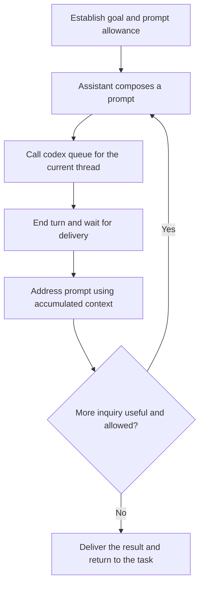

# Meta-prompting

Meta-prompting lets the assistant construct context for its own subsequent work.
It composes a prompt, calls `codex queue` directly, and responds when the host
delivers that prompt as user input in the same conversation. Each next prompt is
chosen from the context that develops.

The prompt may be a question, instruction, definition, or other useful context.
The assistant chooses both its wording and form to suit the task.

## How it works



Codex supplies model execution and message delivery. The skill guides the
assistant in choosing prompts and using their responses to clarify the task,
reconsider assumptions, or bring a wandering conversation back to its goal.

## Use

The assistant may initiate an inquiry when it would help the current task. You
can also ask explicitly:

> Use $meta-prompting to clarify [problem]. Allow up to four prompts. Stop when
> there is one concrete recommendation and a practical way to evaluate it.

The host must support shell commands, provide `codex queue`, and expose
`CODEX_THREAD_ID` for the active conversation. The skill operates through the
existing Codex session.

The assistant operates the queue; you do not need to paste its prompts. For example,
it can submit a prompt using Bash:

```bash
codex queue --thread "${CODEX_THREAD_ID:?Current thread is unavailable}" \
  --message 'What observation would let the user recognize success?'
```

The assistant then ends its turn. A successful command establishes acceptance;
actual arrival must be observed in the conversation before continuing.

## How Codex finds the skill

The source package lives in `skills/meta-prompting/`. Codex looks for project
skills in `.agents/skills/`, so this repository includes a symbolic link at
`.agents/skills/meta-prompting` pointing to the source package. A symbolic link
acts as a shortcut: Codex reads the same files you edit, without a second copy.

`agents/openai.yaml` enables automatic selection. This lets the assistant choose
meta-prompting when it would help your task. You can still request it explicitly
with `$meta-prompting`. If it is missing from the skill selector, restart Codex,
or ask the assistant to read [SKILL.md](SKILL.md) and follow it directly.

This layout separates the distributable package from its local discovery path.
The [Agent Skills specification](https://agentskills.io/specification) defines the
package format; [Codex's skill guide](https://learn.chatgpt.com/docs/build-skills#where-to-save-skills)
defines the installation locations and supports symbolic links. The outer
`skills/` directory is an organizational choice, not a required repository layout.

## Install in another project

Install the package by copying one folder:

1. Download or clone [adamjpatterson/meta-prompting](https://github.com/adamjpatterson/meta-prompting).
2. In the project where you want to use the skill, create `.agents/skills/` if it
   does not already exist.
3. Copy `skills/meta-prompting/` from this repository into that directory. Copy
   the whole folder, including `LICENSE`; the result should look like this:

   ```text
   your-project/
     .agents/
       skills/
         meta-prompting/
           SKILL.md
           README.md
           LICENSE
           agents/
           references/
   ```

4. Open Codex in the destination project and look for `meta-prompting` in
   `/skills`, or type `$meta-prompting`. Restart Codex if it does not appear.

Copy the source folder in step 3, not this repository's symbolic link. If the
destination already contains `meta-prompting`, review that installation before
replacing it.

To make the skill available across your projects instead, copy the same folder
to `~/.agents/skills/meta-prompting/`. Choose either a project installation or a
personal installation to avoid duplicate entries.

### Try it

Ask the assistant to check that `codex queue --help` works in its execution
environment, then try:

> Use $meta-prompting for a one-prompt delivery check. Queue the question
> “What is the purpose of this skill?” to this conversation, respond when it
> arrives, then stop without queueing another prompt.

You should see the question arrive as a new user-input message in the same
conversation, followed by the assistant's response. The inquiry should end there.

## Compatibility and validation

Development checks used Codex CLI **0.169.0** on Linux with Bash and an active
Codex conversation. See the [validation notes](references/validation.md) for the
checks performed and their results.

### If queueing is blocked

`codex queue` needs to communicate with the local Codex app server. A restricted
execution environment may block access to the server's local files or connection.
In our development environment, the command worked when run with broader host
permissions. If this happens, the assistant should report the error and use the
host's normal approval process for the required access.

## State and stopping

The assistant keeps the goal, prompt allowance, and pending prompt in the
conversation. It sends one prompt at a time and stops when the goal is met or the
allowance is exhausted. The assistant tracks this allowance itself.

If sending fails with an uncertain outcome, the assistant stops instead of
retrying automatically: the prompt may already have been accepted. It also
respects new user directions, including a request to stop while a prompt is
pending.

## Package

| File | Purpose |
| --- | --- |
| [SKILL.md](SKILL.md) | Assistant-facing workflow and stopping instructions |
| [agents/openai.yaml](agents/openai.yaml) | Display metadata and automatic selection |
| [references/example.md](references/example.md) | Illustrative inquiry |
| [references/validation.md](references/validation.md) | Validation scope and results |
| [LICENSE](LICENSE) | MIT license for the standalone package |

The skill folder can be copied without depending on other files in this repository.
